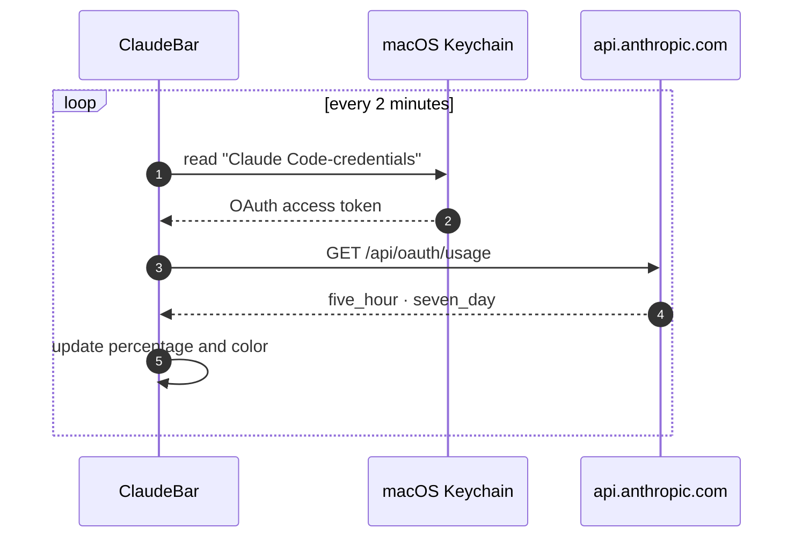

<div align="center">


# ClaudeBar

**Your Claude usage, one glance away.**<br>
A tiny native macOS menu bar app that shows how much of your Claude plan you've used.

[](https://github.com/MichelleBudri/my-claude-bar/actions/workflows/build.yml)
[](#install)
[](Package.swift)
[](LICENSE)

**English** · [Português](README.pt-BR.md)

[Features](#features) · [Install](#install) · [How it works](#how-it-works) · [Privacy](#privacy) · [Troubleshooting](#troubleshooting)

<br>


</div>

<br>

<a id="features"></a>

## ✨ Features

<table>
<tr>
<td width="50%" valign="top">

### 👀 Always visible
Your 5-hour session usage sits in the menu bar next to a Claude-style starburst, so you don't need to open anything.

</td>
<td width="50%" valign="top">

### 🚦 Color by level
The item stays the default color up to 50%, turns **🟡 yellow** above 50% and **🔴 red** above 80%.

</td>
</tr>
<tr>
<td valign="top">

### 📊 Session + weekly
Click it to see the 5-hour **session** and the 7-day **weekly** limits, and when each one resets.

</td>
<td valign="top">

### 🔄 Always fresh
It refreshes every 2 minutes on its own. Press <kbd>⌘</kbd> <kbd>R</kbd> to refresh now.

</td>
</tr>
<tr>
<td valign="top">

### ⚡ Zero setup
It reuses the login you already have in Claude Code. You don't need an API key or any configuration.

</td>
<td valign="top">

### 🪶 Native and light
It's pure Swift and SwiftUI with no dependencies, no Dock icon and no window, and can launch at login.

</td>
</tr>
</table>

<a id="install"></a>

## 📦 Install

> [!NOTE]
> **Requirements:** macOS 13 (Ventura) or later · Xcode or the Command Line Tools (Swift 5.9+) · [Claude Code](https://claude.com/claude-code) installed and logged in

```bash
git clone https://github.com/MichelleBudri/my-claude-bar.git
cd my-claude-bar
make install
```

This builds `ClaudeBar.app`, copies it to `/Applications` and opens it. To start it automatically, turn on **Abrir ao iniciar sessão** (launch at login) in its menu.

<details>
<summary><b>All <code>make</code> commands</b></summary>
<br>

| Command | What it does |
|---|---|
| `make app` | Builds `build/ClaudeBar.app` |
| `make run` | Builds and opens the app from `build/` |
| `make install` | Builds and installs to `/Applications` |
| `make uninstall` | Quits the app and removes it from `/Applications` |
| `make clean` | Deletes build output |

</details>

> [!TIP]
> The menu text is in Brazilian Portuguese for now.

<a id="how-it-works"></a>

## ⚙️ How it works



1. **Reads the token:** ClaudeBar reads the OAuth token that Claude Code keeps in the Keychain, using `/usr/bin/security`.
2. **Calls the usage endpoint:** it calls the same endpoint as Claude Code's `/usage` command.
3. **Shows two numbers:** from the response it shows `five_hour` (session) and `seven_day` (weekly), each with `utilization` (0-100) and `resets_at`.

ClaudeBar **never refreshes the token itself**. A refresh rotates the token, which would log Claude Code out. When the token expires, just open Claude Code and it renews it.

> [!WARNING]
> The usage endpoint isn't officially documented by Anthropic and may change without notice.

<a id="privacy"></a>

## 🔒 Privacy

- **Where the token goes:** it's only ever sent to `api.anthropic.com`.
- **What the app stores:** no data is stored, logged or sent anywhere else.
- **Access to credentials:** read-only; ClaudeBar never changes your Claude Code credentials.

<a id="troubleshooting"></a>

## 🩺 Troubleshooting

<details>
<summary><b>The menu bar shows <code>…</code></b></summary>
<br>
The first request is still loading. Wait a few seconds or press <kbd>⌘</kbd> <kbd>R</kbd>.
</details>

<details>
<summary><b><code>!</code> and "Faça login no Claude Code"</b></summary>
<br>
There are no Claude Code credentials in the Keychain. Run <code>claude</code> in a terminal and log in.
</details>

<details>
<summary><b><code>!</code> and "Token expirado"</b></summary>
<br>
The OAuth token expired. Open Claude Code and send any message so it renews the token, then press <kbd>⌘</kbd> <kbd>R</kbd>.
</details>

<details>
<summary><b><code>!</code> and "Erro HTTP 429" or "5xx"</b></summary>
<br>
Rate limit or a temporary server issue. ClaudeBar retries every 2 minutes on its own.
</details>

<details>
<summary><b>The icon doesn't show up</b></summary>
<br>
It may be hidden behind the MacBook notch. Quit some other menu bar apps and check that it's running with <code>pgrep -lx ClaudeBar</code>.
</details>

<details>
<summary><b>macOS asks for my Keychain password</b></summary>
<br>
Choose <b>Always Allow</b>. ClaudeBar only reads the item.
</details>

## 🗂️ Project structure

```
Sources/ClaudeBar/
├── ClaudeBarApp.swift      # Entry point, MenuBarExtra
├── UsageModel.swift        # App state and periodic refresh
├── UsageService.swift      # Keychain token + HTTP request
├── Usage.swift             # API response models
├── UsageLevel.swift        # 50% / 80% thresholds, colors, markers
├── MenuBarLabel.swift      # Icon + percentage in the menu bar
├── MenuContent.swift       # Menu items
└── ClaudeIcon.swift        # Starburst icon drawing
Resources/Info.plist        # App bundle metadata (no Dock icon)
assets/                     # README images
scripts/generate-assets.py  # Regenerates the README images
Makefile                    # Build, run, install
```

## 🛣️ Roadmap

- [x] Session usage in the menu bar
- [x] Yellow and red levels
- [x] Launch at login
- [ ] Show session and weekly together (`7% · 10%`)
- [ ] Notifications at 80% and 90%
- [ ] Usage breakdown by product (Claude Code, Chat, Cowork)
- [ ] English menu (follows the system language)
- [ ] Configurable refresh interval

## 📄 License

[MIT](LICENSE) © Michelle Budri Bognar

<br>

<div align="center">
<sub>ClaudeBar is an independent project and is not affiliated with, endorsed by or sponsored by Anthropic.<br>"Claude" is a trademark of Anthropic, PBC.</sub>
</div>
