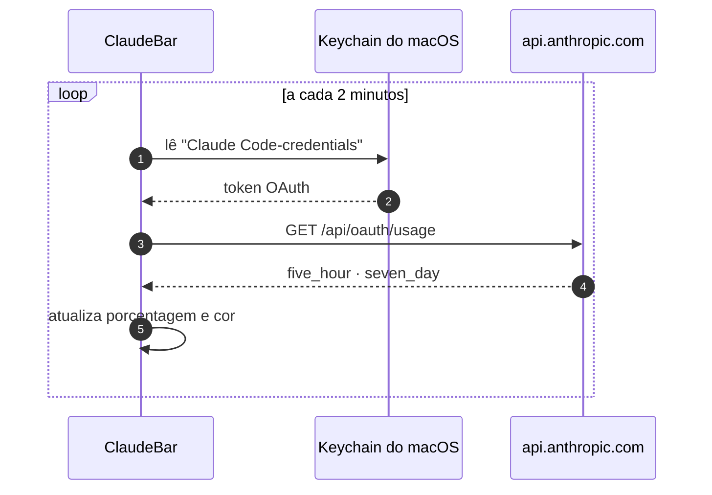

<div align="center">


# ClaudeBar

**Seu uso do Claude, a um olhar de distância.**<br>
Um app nativo e leve para a barra de menus do macOS que mostra quanto do seu plano Claude você já usou.

[](https://github.com/MichelleBudri/my-claude-bar/actions/workflows/build.yml)
[](#instalacao)
[](Package.swift)
[](LICENSE)

[English](README.md) · **Português**

[Funcionalidades](#funcionalidades) · [Instalação](#instalacao) · [Como funciona](#como-funciona) · [Privacidade](#privacidade) · [Problemas](#problemas)

<br>



</div>

<br>

<a id="funcionalidades"></a>

## ✨ Funcionalidades

<table>
<tr>
<td width="50%" valign="top">

### 👀 Sempre visível
A porcentagem da sessão de 5 horas fica na barra de menus, ao lado de um ícone no estilo do Claude. Não precisa abrir nada.

</td>
<td width="50%" valign="top">

### 🚦 Cores por nível
O item fica na cor padrão até 50%, **🟡 amarelo** acima de 50% e **🔴 vermelho** acima de 80%.

</td>
</tr>
<tr>
<td valign="top">

### 📊 Sessão + semanal
Clique para ver o limite da **sessão** (5h) e o **semanal** (7 dias), e quando cada um renova.

</td>
<td valign="top">

### 🔄 Sempre atualizado
Os números se atualizam sozinhos a cada 2 minutos. Use <kbd>⌘</kbd> <kbd>R</kbd> para atualizar na hora.

</td>
</tr>
<tr>
<td valign="top">

### ⚡ Sem configuração
Usa o login que você já tem no Claude Code. Não precisa de chave de API nem de configuração.

</td>
<td valign="top">

### 🪶 Nativo e leve
Feito só com Swift e SwiftUI, sem dependências, sem ícone no Dock e sem janela, e pode abrir ao iniciar sessão.

</td>
</tr>
</table>

<a id="instalacao"></a>

## 📦 Instalação

> [!NOTE]
> **Requisitos:** macOS 13 (Ventura) ou superior · Xcode ou Command Line Tools (Swift 5.9+) · [Claude Code](https://claude.com/claude-code) instalado e com login feito

```bash
git clone https://github.com/MichelleBudri/my-claude-bar.git
cd my-claude-bar
make install
```

O comando compila o `ClaudeBar.app`, copia para `/Applications` e abre o app. Para ele abrir sozinho ao ligar o Mac, ative **Abrir ao iniciar sessão** no menu.

<details>
<summary><b>Todos os comandos <code>make</code></b></summary>
<br>

| Comando | O que faz |
|---|---|
| `make app` | Compila `build/ClaudeBar.app` |
| `make run` | Compila e abre o app a partir de `build/` |
| `make install` | Compila e instala em `/Applications` |
| `make uninstall` | Fecha o app e remove de `/Applications` |
| `make clean` | Apaga os arquivos de build |

</details>

<a id="como-funciona"></a>

## ⚙️ Como funciona



1. **Lê o token:** o ClaudeBar lê o token OAuth que o Claude Code guarda no Keychain, usando `/usr/bin/security`.
2. **Consulta o uso:** chama o mesmo serviço que o comando `/usage` do Claude Code usa.
3. **Mostra dois números:** da resposta, usa `five_hour` (sessão) e `seven_day` (semanal), cada um com `utilization` (0-100) e `resets_at`.

O ClaudeBar **nunca renova o token por conta própria**. A renovação troca o token, o que deslogaria o Claude Code. Quando o token expira, basta abrir o Claude Code, que ele renova sozinho.

> [!WARNING]
> O serviço de uso não é documentado oficialmente pela Anthropic e pode mudar sem aviso.

<a id="privacidade"></a>

## 🔒 Privacidade

- **Para onde vai o token:** só é enviado para `api.anthropic.com`.
- **O que o app guarda:** nenhum dado é armazenado, registrado em log ou enviado para outro lugar.
- **Acesso às credenciais:** só leitura; o ClaudeBar nunca altera as credenciais do Claude Code.

<a id="problemas"></a>

## 🩺 Solução de problemas

<details>
<summary><b>A barra mostra <code>…</code></b></summary>
<br>
A primeira consulta ainda está carregando. Aguarde alguns segundos ou use <kbd>⌘</kbd> <kbd>R</kbd>.
</details>

<details>
<summary><b><code>!</code> e "Faça login no Claude Code"</b></summary>
<br>
Não há credenciais do Claude Code no Keychain. Rode <code>claude</code> no terminal e faça login.
</details>

<details>
<summary><b><code>!</code> e "Token expirado"</b></summary>
<br>
O token OAuth venceu. Abra o Claude Code e mande qualquer mensagem para ele renovar o token. Depois use <kbd>⌘</kbd> <kbd>R</kbd>.
</details>

<details>
<summary><b><code>!</code> e "Erro HTTP 429" ou "5xx"</b></summary>
<br>
Excesso de requisições ou instabilidade temporária. O ClaudeBar tenta de novo sozinho a cada 2 minutos.
</details>

<details>
<summary><b>O ícone não aparece</b></summary>
<br>
O notch do MacBook pode estar escondendo o ícone. Feche outros apps da barra e confira se ele está rodando com <code>pgrep -lx ClaudeBar</code>.
</details>

<details>
<summary><b>O macOS pede a senha do Keychain</b></summary>
<br>
Escolha <b>Permitir sempre</b>. O ClaudeBar só lê o item.
</details>

## 🗂️ Estrutura do projeto

```
Sources/ClaudeBar/
├── ClaudeBarApp.swift      # Ponto de entrada, MenuBarExtra
├── UsageModel.swift        # Estado do app e atualização periódica
├── UsageService.swift      # Token do Keychain + requisição HTTP
├── Usage.swift             # Modelos da resposta da API
├── UsageLevel.swift        # Limites 50% / 80%, cores, marcadores
├── MenuBarLabel.swift      # Ícone + porcentagem na barra
├── MenuContent.swift       # Itens do menu
└── ClaudeIcon.swift        # Desenho do ícone
Resources/Info.plist        # Metadados do app (sem ícone no Dock)
assets/                     # Imagens do README
scripts/generate-assets.py  # Gera de novo as imagens do README
Makefile                    # Compilar, rodar, instalar
```

## 🛣️ Próximos passos

- [x] Uso da sessão na barra de menus
- [x] Níveis amarelo e vermelho
- [x] Abrir ao iniciar sessão
- [ ] Mostrar sessão e semanal juntas (`7% · 10%`)
- [ ] Notificações em 80% e 90%
- [ ] Uso por produto (Claude Code, Chat, Cowork)
- [ ] Menu em inglês (seguindo o idioma do sistema)
- [ ] Intervalo de atualização configurável

## 📄 Licença

[MIT](LICENSE) © Michelle Budri Bognar

<br>

<div align="center">
<sub>O ClaudeBar é um projeto independente, sem afiliação, endosso ou patrocínio da Anthropic.<br>"Claude" é uma marca registrada da Anthropic, PBC.</sub>
</div>
